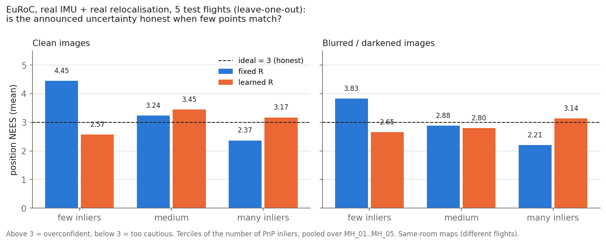
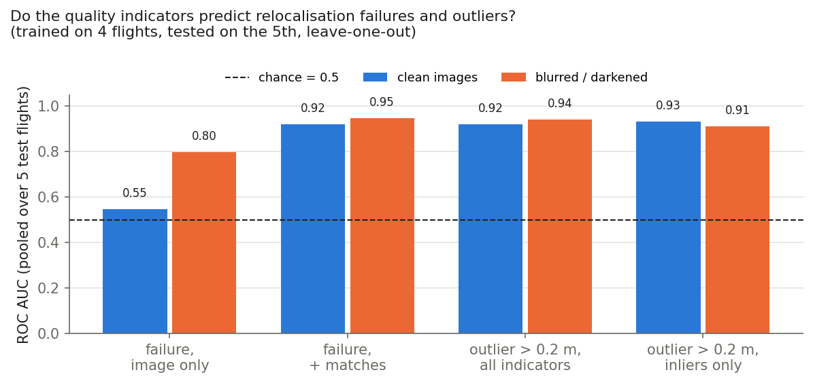

# Learned confidence for visual navigation (IMU + vision)

A Kalman filter fuses an IMU (fast, but drifts) with a visual position fix (corrects the drift, but its quality depends on the scene: texture, light, blur).

**Question.** Can the measurement noise covariance $R_k$ of the visual fix be **predicted at every measurement** from observable quality indicators (number of matches, inliers, brightness, sharpness...) instead of being a hand-tuned constant? Does the filter become more accurate, and more *honest* about its uncertainty (statistically consistent)?

This is an exploration, first in a 2D simulation, then on real data (EuRoC MAV: real IMU, real images, real visual position fixes obtained by relocalising each image against a prior map).

## At a glance

| Experiment | IMU | Visual position | Images | Accuracy: fixed R → learned R | Honesty (consistency) |
|---|---|---|---|---|---|
| **A.** 2D simulation (§A) | simulated | simulated | none (simulated indicators) | RMSE 0.97 → **0.81 m (−17 %)** | NIS coverage 0.73 → 0.93 (ideal 0.95) |
| **B.3** EuRoC, clean images | **real** | **real** (PnP against a map of the same room from other flights) | **real** | RMSE 6.7 → 9.0 cm, median 5.5 → 5.3 cm: **no significant gain** | position NEES stays near 3 whatever the number of inliers (fixed: 4.5 with few, 2.4 with many) |
| **B.4** EuRoC, degraded images | **real** | **real** | real + **synthetic** blur / darkening | median 6.4 → 6.2 cm: **no significant gain** | same pattern by inliers; no clear difference by degradation level |
| **B.5** Predicting failures and outliers | — | **real** | real (+ synthetic degradation) | — | indicators predict relocalisation **failures (AUC 0.92-0.95)** and **outliers > 0.2 m (AUC 0.92-0.94)** on unseen flights |
| **B.6** Outlier detector inside the filter | **real** | **real** | real (+ synthetic degradation) | removes 64-88 % of accepted outliers but **does not improve accuracy** (RMSE +2 to +16 cm, not significant): it also drops 11-14 % of good fixes | fixed R + detector: overconfidence with few inliers drops (NEES 4.45 → 3.29 clean, 3.83 → 2.98 degraded) |

Real data protocol: nested leave-one-out over the five EuRoC Machine Hall flights (every model, threshold and tuning factor is fitted without the test flight; the test flight's map also excludes it). n = 5 flights, so confidence intervals are wide.

**What is real and what is not.** Real: the IMU, the images, the camera calibration, the ground truth (Leica laser tracker + batch estimation, an estimate itself), the relocalisation measurements and their errors. Synthetic: the 2D simulation (§A), the blur and darkening applied to the images in B.4. Simplifying choices: maps are built with ground-truth poses and **all maps are of the same room** (different flights), much easier than a real deployment against e.g. satellite imagery; the filter is initialised with the ground-truth position and attitude (gyro bias estimated from the IMU at rest).

**Main findings.**
1. The −17 % accuracy gain seen in simulation **does not transfer** to real map-based relocalisation.
2. The learned R keeps the filter **uniformly honest** across scene quality: the fixed filter is overconfident when few points match and too cautious when many do. Its calibration also transfers better from one set of flights to another.
3. With this kind of measurement, image quality decides **whether** a fix is obtained much more than **how good** it is (successful fixes keep a few-cm error even on degraded images). The quality indicators **predict failures and outliers very well**, which the filter's innovation gate does not catch.
4. But **rejecting the predicted outliers does not make the filter more accurate** here: the detector's precision is low, so it also throws away good fixes, and the gaps cost more than the (mostly 20-30 cm) outliers did. How to act on the prediction (threshold tuned for navigation error, down-weighting instead of rejecting, outage handling) is the open question.





**About the "17 m drift in 5 s".** During validation the IMU alone drifted 17 m in 5 s while stationary. This is **real, not a bug**: the gyro bias of this IMU (ADIS16448) is large (≈0.077 rad/s on the axes that tilt gravity, i.e. 4.4°/s), and a tilt error leaks gravity into the acceleration, giving a position error $g\,|b_g|\,t^3/6$ = 15.8 m at 5 s (16.0 m simulated). Checked: gravity at rest matches within 0.02 m/s², the ground-truth angular velocity matches the gyro with a 0.00° frame rotation and 0 ms time offset, and with the ground-truth biases the drift drops to 0.4 m (`check_imu.py`, `tests/test_eskf.py`). It came from initialising the gyro bias at zero; the experiments estimate it from the IMU at rest (error 0.001-0.006 rad/s).

## Data: EuRoC MAV

Real-data experiments use the EuRoC MAV dataset, Machine Hall sequences MH_01_easy … MH_05_difficult (ASL format):

> M. Burri, J. Nikolic, P. Gohl, T. Schneider, J. Rehder, S. Omari, M. W. Achtelik, R. Siegwart, "The EuRoC micro aerial vehicle datasets", *International Journal of Robotics Research*, 35(10), 2016. doi:[10.1177/0278364915620033](https://doi.org/10.1177/0278364915620033)

Dataset page: <https://projects.asl.ethz.ch/datasets/euroc-mav/>, files on the ETH Research Collection, doi:[10.3929/ethz-b-000690084](https://doi.org/10.3929/ethz-b-000690084). **The dataset is not redistributed here** (`data/` is git-ignored). Rights statement on the ETH Research Collection record: **"In Copyright - Non-Commercial Use Permitted"** (a rights statement, not a Creative Commons license). This project uses the data for non-commercial research only and does not redistribute it.

Setup: download the Machine Hall ASL zips, unzip the CSV and YAML files (`mav0/imu0`, `mav0/state_groundtruth_estimate0`, `mav0/cam0/data.csv`, `mav0/cam0/sensor.yaml`, `mav0/cam1/sensor.yaml`, `mav0/leica0`, `mav0/body.yaml`) into `data/<sequence>/`. Images are read directly from the original zips (default path `~/Downloads/machine_hall/<sequence>/<sequence>.zip`, overridable on the command line).

## Limitations (read before presenting)

- **Same-room maps.** The relocalisation map comes from other flights in the same room, built with ground-truth poses. A real system matches against a reference that differs far more from the live view (season, altitude, sensor).
- **Five flights.** Confidence intervals across flights are wide; per-flight numbers are in the JSON files.
- **Time-correlated visual errors.** Neighbouring views share the same map landmarks, so relocalisation errors are correlated over seconds (autocorrelation 0.66 at 0.1 s, 0.35 at 2 s). Both filters handle this with an R inflation factor fitted on training flights. This restores the position NEES but makes the NIS meaningless (0.1-1 instead of 3). Modelling the correlation in the state (Gauss-Markov measurement bias) would be the principled fix; not done.
- **Initialisation from ground truth** (position, attitude); 9-dof NEES (with velocity and attitude) around 15 for both filters, i.e. still overconfident on velocity/attitude, or the ground-truth attitude (estimated from this same IMU) is not accurate enough for that test.
- **Simple models**: linear log-variance model, isotropic $R_k$, logistic regression for failures/outliers. The outlier detector's threshold (80 % recall on training) was fixed a priori, not tuned for navigation error.
- **Synthetic degradations** (Gaussian blur, gain + read noise), not real night or motion-blur footage.

## Run

```
pip install -r requirements.txt
python -m pytest -q tests                # 12 tests; real-data tests are skipped without data/
python run_experiment.py                 # A: 2D simulation (~25 s)
python check_euroc.py; python check_imu.py; python check_eskf.py data/MH_01_easy 10 1   # B.1 checks
python run_reloc.py                      # B.2 strict map (MH_01+MH_02) -> MH_03..05
python run_reloc_loo.py                  # B.3 nested leave-one-out relocalisation (~15 min)
python run_reloc_loo.py --degrade        # B.4 same with degraded query images
python run_euroc_experiment.py           # B.3 fixed vs learned R (+ B.6 outlier-flag variants)
python run_euroc_experiment.py --degraded   # B.4
python run_failure_prediction.py; python run_failure_prediction.py --clean   # B.5
python make_figures.py                   # fig3, fig4
```

The equations render on GitHub and in VS Code's Markdown preview.

---

## Part A — 2D simulation

### A.1 State-space model

State $x = [p^\top, v^\top, b^\top]^\top \in \mathbb{R}^6$ (position, velocity, accelerometer bias, all 2D). The IMU provides the measured acceleration $u_k = a_k + b_k + w_k$, $w_k \sim \mathcal{N}(0, \sigma_a^2 I)$, and the bias follows a random walk with intensity $\sigma_b$.

**Prediction** (100 Hz, $\Delta t = 0.01$ s, IMU as control input):

$$
x_{k+1} = F x_k + B u_k, \qquad P_{k+1} = F P_k F^\top + Q
$$

$$
F = \begin{bmatrix} I & \Delta t\, I & -\tfrac12 \Delta t^2 I \\ 0 & I & -\Delta t\, I \\ 0 & 0 & I \end{bmatrix}, \quad
B = \begin{bmatrix} \tfrac12 \Delta t^2 I \\ \Delta t\, I \\ 0 \end{bmatrix}, \quad
Q = \sigma_a^2 B B^\top + \mathrm{diag}(0, 0, \sigma_b^2 \Delta t\, I)
$$

**Update** (10 Hz, visual position, $H = [I\ 0\ 0]$):

$$
z_k = H x_k + n_k, \quad n_k \sim \mathcal{N}(0, R_k), \quad R_k = r_k I_2
$$

$$
\nu_k = z_k - H \hat{x}_k^-, \quad S_k = H P_k^- H^\top + R_k, \quad K_k = P_k^- H^\top S_k^{-1}
$$

$$
\hat{x}_k^+ = \hat{x}_k^- + K_k \nu_k, \qquad P_k^+ = (I - K_k H) P_k^- (I - K_k H)^\top + K_k R_k K_k^\top \ \text{(Joseph form)}
$$

The whole difference between the three filters below is **how $r_k$ is chosen**.

### A.2 Three ways to choose $r_k$

| Filter | $r_k$ | Comment |
|---|---|---|
| **fixed** | $\bar r = \dfrac{1}{2K}\sum_k \lVert e_k \rVert^2$ | Best constant variance on the training set (it minimizes the NLL below among constants) |
| **learned** | $\hat r_k = \exp\!\big(w^\top \phi(f_k)\big)$ | Predicted from indicators $f_k$ (this work) |
| **oracle** | $r_k = \sigma(q_k)^2$ | True variance. Not realizable: it is the upper bound for any $r_k$ policy |

where $e_k = z_k - p_k$ is the visual error (known on training flights, where ground truth is available).

**Learned confidence.** Indicators $f_k \in \mathbb{R}^4$: $\log(1 + n_{\text{matches}})$, matching score, texture, brightness. Features are standardized, $\phi(f) = [1,\ (f - \mu)/s]$, and the log-variance is linear in them, $\log \hat r_k = w^\top \phi(f_k)$. Training minimizes the Gaussian negative log-likelihood of the visual error ($m$ = 2 axes here, 3 on EuRoC), with a small ridge penalty $\lambda = 10^{-3}$ on the non-bias weights:

$$
\mathcal{L}(w) = \frac{1}{K} \sum_{k=1}^{K} \frac12 \left[ m \log \hat r_k + \frac{\lVert e_k \rVert^2}{\hat r_k} \right] + \lambda \lVert w_{1:} \rVert^2
$$

Why this loss: the NLL is a *proper scoring rule*. Its minimizer is $\hat r(f) = \mathbb{E}[\lVert e \rVert^2 \mid f] / m$, i.e. the true conditional variance per axis. It penalizes overconfidence and underconfidence alike, so the model cannot "cheat" by being uniformly cautious. Optimization is L-BFGS on the analytic gradient; $\log \hat r_k$ is clipped as a numerical guard ($[-4, 8]$ in 2D, $[-14, 6]$ on EuRoC where errors are centimetric).

### A.3 Evaluation: consistency tests

A filter is *consistent* if its covariance matches its actual errors. Two standard statistics (Bar-Shalom et al.):

$$
\mathrm{NIS}_k = \nu_k^\top S_k^{-1} \nu_k \ \sim\ \chi^2_{\dim z}
\qquad
\mathrm{NEES}_k = (\hat x_k - x_k)^\top\, P_k^{-1}\, (\hat x_k - x_k) \ \sim\ \chi^2_{\dim x}
$$

| Statistic | Needs ground truth | Ideal (2D) | Check used here |
|---|---|---|---|
| NIS | **no** (usable in flight) | $\mathbb{E}[\mathrm{NIS}] = 2$ | share inside $[\chi^2_{2,\,0.025},\ \chi^2_{2,\,0.975}] = [0.051,\ 7.378]$, ideal 0.95 |
| NEES (position + velocity, 4 dof) | yes (offline) | $\mathbb{E}[\mathrm{NEES}] = 4$ | share below $\chi^2_{4,\,0.95} = 9.488$, ideal 0.95 |

On EuRoC: NIS has 3 dof (ideal 3), the position NEES 3 dof (ideal 3), the full NEES 9 dof (position, velocity, attitude; ideal 9). A global mean can hide opposite errors that cancel out, so the NEES is also reported **by scene quality**.

### A.4 Simulator and results

- Commanded acceleration: Ornstein-Uhlenbeck process ($\tau = 5$ s, stationary std 0.8 m/s²) with light damping $-0.15\,v$; IMU noise $\sigma_a = 0.05$ m/s², bias walk $\sigma_b = 0.005$.
- Latent scene quality $q_k = \mathrm{sigmoid}(1.5\, z_k + 0.5)$ with $z_k$ an OU process ($\tau = 10$ s).
- True visual noise per axis: $\sigma(q) = 0.5 + 10\,(1 - q)^2$ m (0.5 m in a perfect scene, 10.5 m in the worst).
- Observable indicators (noisy functions of $q$): $n_{\text{matches}} \sim \mathrm{Poisson}(10 + 190q)$; score $= 0.3 + 0.6q + \mathcal{N}(0, 0.08^2)$; texture $= q^{0.7} + \mathcal{N}(0, 0.12^2)$; brightness $= 0.3 + 0.4q + \mathcal{N}(0, 0.15^2)$ (weak indicator, almost a distractor). Clipped to $[0,1]$ where relevant.
- Protocol: 12 training flights (seeds 0-11), 20 unseen test flights (seeds 100-119), 200 s each, first 10 s discarded.

Files: `src/sim.py`, `src/kf.py`, `src/learn_R.py`, `src/consistency.py`, `run_experiment.py`, `tests/test_filter.py`.

| | Position RMSE (m) | RMSE in poor scenes (m) | Mean NIS (ideal 2) | Mean NEES (ideal 4) | NIS inside 95 % interval (ideal 0.95) |
|---|---|---|---|---|---|
| fixed | 0.97 | 1.44 | 1.98 | 4.15 | 0.73 |
| **learned** | **0.81** | **1.27** | 2.00 | 4.46 | **0.93** |
| oracle | 0.75 | 1.17 | 1.99 | 4.14 | 0.95 |

Mean NEES by scene quality (ideal 4):

| scene | fixed | learned | oracle |
|---|---|---|---|
| poor ($q < 0.4$) | **7.2** (overconfident) | 4.6 | 3.9 |
| medium | 3.7 | 5.0 | 4.2 |
| good ($q > 0.7$) | **2.5** (too cautious) | 3.9 | 4.3 |

- **Accuracy:** RMSE −17 % vs fixed (0.974 → 0.807 m), which closes 73 % of the gap to the oracle (0.746 m); −11 % in poor scenes.
- **Honesty:** the fixed filter's global NIS and NEES look fine (1.98, 4.15) but hide two defects that cancel out: overconfident in poor scenes (NEES 7.2), too cautious in good ones (2.5). The learned filter stays near 4 in both. It is slightly overconfident in medium scenes (5.0).
- **Sanity check:** the oracle filter has NIS ≈ 2 and NEES ≈ 4, which validates the filter implementation itself.
- **Caveat:** the noise and the indicators are generated with a structure the model can recover, so the learned filter has an easy job here. Part B tests this on real data.

Figures: `results/fig1_error_vs_time.png`, `results/fig2_calibration.png`. Raw numbers: `results/metrics.json`.

---

## Part B — EuRoC MAV (real IMU, real images)

### B.1 3D ESKF and its validation

`src/euroc.py` loads a sequence (IMU, ground truth, camera timestamps; ground truth interpolated linearly, slerp for the quaternion). `src/eskf.py`: error-state Kalman filter (position, velocity, quaternion attitude with a local error, accelerometer and gyro biases; 15-dim error state; Solà's conventions) with 3D position updates, optional innovation gating and gate recovery. `src/vis_synth.py`: synthetic visual position (ground truth + scene-quality-dependent noise), used only for these checks and for tuning the IMU noise.

Checks (`pytest tests`, `check_imu.py`, `check_eskf.py data/MH_01_easy 10 1`):

1. Noise-free propagation matches an analytic trajectory (error is second order in dt).
2. The error-state Jacobians match central finite differences (max error < 1e-7).
3. Gravity, frame and timing: see "About the 17 m drift" above. IMU only on the stationary segment, zero initial biases: the drift (17 m at 5 s) stays inside the covariance the filter predicts (actual 3D error / predicted 3D sigma ≈ 0.96).
4. Oracle filter (true synthetic visual variance) on the real IMU: NIS 3.00 (ideal 3), 95 % coverage 0.950; NEES (9 dof) 8.0 (ideal 9).

Caveat on 4: with the datasheet IMU noise densities the NEES was 36 instead of 9 (with zero initial gyro bias). The white-noise scale is a tuning factor; in the experiments below it is chosen on the training flights only (selected ×3 to ×5 once the gyro bias is estimated at rest).

### B.2 Real visual measurement: relocalisation against a prior map

`src/reloc.py`, `run_reloc.py`: a map is built from reference flights (stereo SIFT landmarks triangulated with the calibrated extrinsics, placed in the world frame with the ground-truth keyframe poses). Each cam0 frame of a query flight (10 Hz) is localised on its own: SIFT, nearest-neighbour matching against the whole map (no position prior), PnP + RANSAC, LM refinement. This gives a **real** position fix with a **real** error, and real quality indicators: matches, inlier ratio, inliers, reprojection RMS, image coverage of inliers, brightness, sharpness. The five Machine Hall flights share one world frame (checked: ground-truth start points coincide within ~0.2 m, and frames with the same ground-truth pose in different flights show the same view).

**Strict map (MH_01 + MH_02 only), kept as a stress test:**

| query | frames | success | median error | p90 | p99 | max |
|---|---|---|---|---|---|---|
| MH_03_medium | 1316 | 0.57 | 0.027 m | 0.12 m | 0.30 m | 0.8 m |
| MH_04_difficult | 988 | 0.18 | 0.080 m | 0.29 m | 1.4 m | 5.1 m |
| MH_05_difficult | 1111 | 0.22 | 0.086 m | 0.26 m | 2.4 m | 10.0 m |

Failures are a map-coverage problem, not darkness: when a map pose exists within 1 m with a viewing direction within 45°, success is 0.89-1.00 (including the dark flights); otherwise 0.03-0.19. Indicators predict the error (Spearman with log error, 1165 fixes): matches −0.57, inliers −0.56, inlier ratio −0.51, coverage −0.42, reprojection RMS +0.33, brightness −0.32.

**Leave-one-out maps** (`run_reloc_loo.py`): for each flight, a map from the four others → success 0.95-1.00, median error 1.5-4 cm. Nested maps (without the test flight and without the training flight being localised) provide the training data, so nothing is fitted on a map that has seen the flight it localises.

### B.3 Fixed vs learned R (nested leave-one-out)

`run_euroc_experiment.py`, raw numbers in `results/euroc_exp/metrics.json`. For each test flight: test fixes from a map built without it; R models, the R inflation factor α and the IMU noise scale fitted on the four other flights only. Both filters share the same innovation gate (χ²₃, 0.999) and recovery rule (after 1 s without an accepted fix, the next one is accepted). Initialisation at the end of the first stationary window (≥ 3 s): ground-truth position and attitude, zero velocity, gyro bias = mean gyro at rest, accelerometer bias 0.

Why α: the relocalisation errors are correlated in time, which a white-noise R cannot express. A first run without it had position NEES 13 instead of 3 on a good flight and diverged (km) on others: the overconfident filter rejected every fix through the gate. Each filter uses α·r_k, α chosen on the training flights so that the position NEES is closest to 3 (selected: fixed 0.125-4, learned 16).

| 5 test flights (mean) | fixed | learned | learned − fixed, 95 % t-interval (n = 5) |
|---|---|---|---|
| position RMSE (all 10 Hz frames) | 0.067 m | 0.090 m | +0.023 [−0.012, +0.057] |
| median position error | 0.055 m | 0.053 m | −0.002 [−0.012, +0.007] |
| position NEES (ideal 3) | 3.22 | 3.02 | −0.20 [−2.4, +2.0] |
| position NEES below χ²₃ 95 % (ideal 0.95) | 0.91 | 0.93 | +0.02 [−0.10, +0.14] |

Position NEES (ideal 3) by number of PnP inliers (pooled terciles): fixed 4.45 / 3.24 / 2.37 (few / medium / many), learned 2.57 / 3.45 / 3.17 (fig. 3).

Stress test (strict map, 20-50 % success, models trained on the leave-one-out maps): learned has lower RMSE on the 3 flights (MH_03 5.7 vs 6.5 m, MH_04 26 vs 53 m, MH_05 91 vs 141 m) and position NEES closer to 3 (2.2 / 2.0 / 3.5 vs 5.0 / 2.1 / 7.1). Both are unusable in absolute terms: long gaps without fixes leave the filter on the IMU alone.

- **No accuracy gain** with a dense map; the simulation result does not transfer.
- **More uniform honesty** across scene quality, and **less degradation under distribution shift** (3 flights only).
- **NIS is no longer a valid check** with α (0.1-1.0 instead of 3 for both): with time-correlated errors the filter follows them, so innovations are small while the estimate carries the error.

### B.4 Degraded images (blur, darkening)

`src/degrade.py`, `run_reloc_loo.py --degrade`, `run_euroc_experiment.py --degraded`, raw numbers in `results/euroc_exp_degraded/metrics.json`. Query images (training and test, never the map) are blurred (Gaussian, up to 6 px) and darkened (gain down to 0.08, plus 2 DN read noise), with two independent slowly varying latent processes per flight (about half the frames clean or mildly degraded). On 40 MH_03 frames: blur 3 px drops success to 0.78, 4 px to 0.50; gain 0.15 to 0.20; the error of the *successful* fixes hardly grows (median 2-3 cm in every condition). Success with the leave-one-out maps falls from 0.95-1.00 to 0.56-0.93.

| 5 test flights (mean) | fixed | learned | learned − fixed, 95 % t-interval (n = 5) |
|---|---|---|---|
| position RMSE | 1.73 m | 1.78 m | +0.05 [−0.06, +0.16] |
| median position error | 0.064 m | 0.062 m | −0.002 [−0.015, +0.011] |
| position NEES (ideal 3) | 2.83 | 2.84 | +0.02 [−1.7, +1.7] |

The RMSE is dominated by MH_04 (8 m for both): 45 % of its frames fail and the filter coasts on the IMU.

| position NEES (ideal 3) | few inliers | medium | many | clean (sev < 0.2) | moderate | strong (sev ≥ 0.5) |
|---|---|---|---|---|---|---|
| fixed | 3.83 | 2.88 | 2.21 | 3.05 | 3.33 | 2.41 |
| learned | 2.65 | 2.80 | 3.14 | 3.20 | 2.72 | 2.31 |

- **Still no accuracy gain.** By number of inliers the learned filter stays more uniformly honest; by degradation severity neither is clearly better.
- **Why:** degradation mostly turns fixes into failures (no measurement), while successful fixes keep a few-cm error, so a learned R has little error variation to exploit. That is a property of this kind of map-matching measurement.
- The fixed filter's α varies widely across folds (0.125 to 8) because its constant R is driven by the heavy tail of the training errors; the learned filter's α is stable (8-16).

### B.5 Do the indicators predict failures and outliers?

`run_failure_prediction.py [--clean]`, raw numbers in `results/failure_prediction_{degraded,clean}.json`. Same nested leave-one-out protocol. Model: class-balanced L2 logistic regression. Metric: ROC AUC (0.5 = chance, 1 = perfect), pooled over the 5 test flights.

| question | features | AUC degraded | AUC clean |
|---|---|---|---|
| relocalisation **failure** | brightness, sharpness (image only, before any matching) | 0.80 | 0.55 |
| relocalisation **failure** | + number of descriptor matches (before PnP) | 0.95 | 0.92 |
| **outlier** among successes (error > 0.2 m) | all 7 indicators | 0.94 | 0.92 |
| **outlier** among successes (error > 0.2 m) | number of PnP inliers alone | 0.91 | 0.93 |

Degraded set: 937 failures out of 6734 frames (14 %), 113 outliers out of 5797 fixes (2 %). Clean set: 98 failures, 92 outliers.

- **Yes, strongly**, on flights never seen in training. Image-only indicators predict failures only when the images are actually degraded; the number of matches does it in both cases. The number of PnP inliers alone does almost all the work for outliers.
- **The filters' gate does not catch these outliers**: both filters accepted 99.8-100 % of the fixes (with α the gate is wide). An indicator-based flag is complementary.
- Caveats: outliers are rare (5 to 51 per test flight), so per-flight AUCs are noisy; at a threshold giving 80 % recall on training, precision on test is low (3-25 %).

### B.6 Using the outlier detector inside the filter

Same experiment as B.3/B.4 with two more variants, "fixed + flag" and "learned + flag": the B.5 logistic detector (all 7 indicators, outlier = error > 0.2 m), trained per fold on the training flights only, threshold at 80 % recall on training; flagged fixes are dropped before the filter, and α is re-tuned for each variant like the others. Numbers in `results/euroc_exp{,_degraded}/metrics.json` (keys `fixed+flag`, `learned+flag`, `flag_effect_*`).

| 5 test flights (mean) | clean: fixed → +flag | clean: learned → +flag | degraded: fixed → +flag | degraded: learned → +flag |
|---|---|---|---|---|
| outliers accepted per flight | 14.4 → 5.2 | 16.4 → 5.2 | 16.2 → 2.4 | 17.6 → 2.2 |
| fixes dropped by the flag | 11 % | 11 % | 14 % | 14 % |
| position RMSE | 0.067 → 0.091 m | 0.090 → 0.162 m | 1.73 → 1.81 m | 1.78 → 1.94 m |
| median position error | 0.055 → 0.055 m | 0.053 → 0.053 m | 0.064 → 0.059 m | 0.062 → 0.061 m |
| position NEES, few-inliers tercile (ideal 3) | 4.45 → 3.29 | 2.57 → 2.56 | 3.83 → 2.98 | 2.65 → 2.86 |

All RMSE differences are within their 95 % t-intervals (n = 5).

- **The detector does what it was trained for**: it removes 64-88 % of the accepted outliers.
- **It does not improve accuracy; RMSE and max error get slightly worse.** Per flight, the cost comes from where it drops many fixes: on MH_03 it drops 25 % (clean) to 35 % (degraded) of the fixes, gate recoveries rise (0.2 % → 1.7-2.8 %), and the RMSE grows (0.086 → 0.101 m clean, 0.097 → 0.327 m degraded). Where it drops few (MH_01 and MH_05 degraded) the RMSE improves slightly. The outliers are mostly 20-30 cm while the filter, with its inflated R, already smooths them; the gaps cost more.
- **For the fixed filter it removes the overconfidence on poor fixes** (few-inliers NEES 4.45 → 3.29 clean, 3.83 → 2.98 degraded): the same effect the learned R obtains by scaling.
- Not tried (to keep the protocol clean): tuning the threshold for navigation error on the training flights, or down-weighting instead of rejecting.

## References

- Y. Bar-Shalom, X. R. Li, T. Kirubarajan, *Estimation with Applications to Tracking and Navigation*, Wiley, 2001 (NIS / NEES consistency tests).
- J. Solà, *Quaternion kinematics for the error-state Kalman filter*, 2017 (ESKF conventions).
- T. Gneiting, A. Raftery, "Strictly proper scoring rules, prediction, and estimation", JASA 102(477), 2007 (NLL as a proper scoring rule).
- M. Burri et al., "The EuRoC micro aerial vehicle datasets", IJRR 35(10), 2016, doi:10.1177/0278364915620033 (dataset).
- D. G. Lowe, "Distinctive image features from scale-invariant keypoints", IJCV 60(2), 2004 (SIFT).
